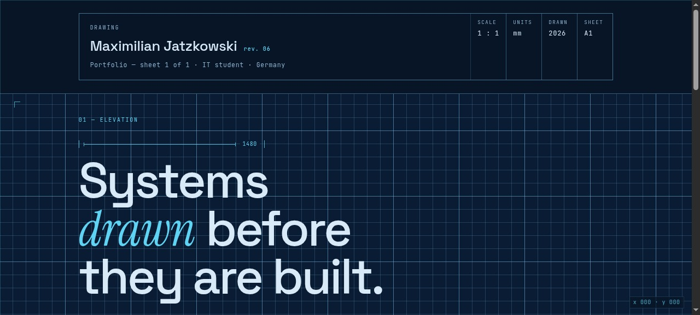

<div align="center">
  
</div>

<h1 align="center">Blueprint</h1>

<p align="center"><em>A portfolio presented as a technical drawing.</em></p>

<p align="center">
  <a href="https://noxwer-beep.github.io/blueprint/">Live</a> ·
  <a href="https://noxwer-beep.github.io/showcase/">All eight concepts</a> ·
  <a href="https://noxwer-beep.github.io/portfolio/">Portfolio</a>
</p>

---

A drawing sheet is a document that explains itself: dimensions, leaders, part
numbers, a title block. This homepage borrows that grammar instead of the usual
hero-and-cards layout — the content is annotated rather than decorated.

## What is in here

```
index.html   structure, and the sheet annotations
style.css    the drawing: rules, hatching, dimension marks
main.js      scroll reveals and the pointer-driven sheet details
css/         self-hosted fonts (Space Grotesk, IBM Plex Mono, Fraunces)
```

Three files, no framework, no build step, no bundler. Open `index.html` and it works.

## Run it

```bash
python3 -m http.server 8000
# http://localhost:8000
```

## What it demonstrates

- **Annotation as layout.** Labels sit on leader lines; the grid is visible because
  a drawing shows its own construction.
- **`IntersectionObserver` reveals** that fire once and never re-run — the page
  settles instead of animating forever.
- **Pointer position as a variable**, so the sheet reacts to the cursor without a
  single animation frame running when nobody is looking.

## Related

- [showcase](https://github.com/Noxwer-beep/showcase) — the gallery these came from,
  with the design notes for each direction
- [portfolio](https://github.com/Noxwer-beep/portfolio) — the real site

MIT.
